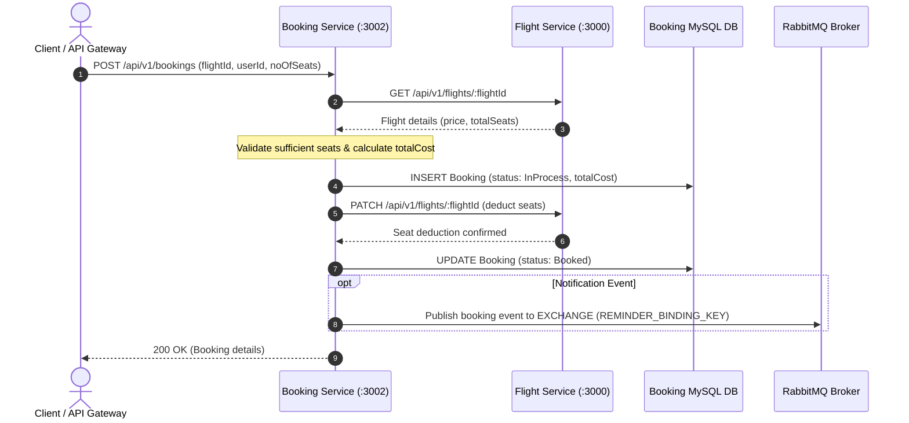

# Airline Booking Service

## Overview
The **Airline Booking Service** orchestrates ticket reservation workflows and seat lifecycle management. It acts as an integration hub between the passenger request, inventory deduction in the **Flights & Search Service**, transactional persistence in MySQL, and asynchronous notification delivery via **RabbitMQ** to the **Reminder Service**.

---

## Booking Transaction Workflow



---

## Tech Stack
- **Runtime**: Node.js (v18+)
- **Framework**: Express 5
- **ORM**: Sequelize v6
- **Database**: MySQL (`mysql2` driver)
- **Message Broker**: RabbitMQ via `amqplib`
- **HTTP Client**: Axios
- **Logging**: Morgan
- **Error Handling & Statuses**: `http-status-codes`
- **Environment Management**: `dotenv`
- **Development Tooling**: `nodemon`, `sequelize-cli`

---

## Environment Variables

Copy `.env.example` into `.env`:

```bash
cp .env.example .env
```

| Variable Name | Required | Default Value | Description |
| :--- | :---: | :--- | :--- |
| `PORT` | Required | `3002` | Port on which the Booking Service listens. API Gateway routes `/bookingservice` here. |
| `FLIGHT_SERVICE_PATH` | Required | `http://localhost:3000` | Base URL of the Flights & Search Service. |
| `MESSAGE_BROKER_URL` | Required | `amqp://localhost:5672` | RabbitMQ connection URI. |
| `EXCHANGE_NAME` | Required | `AIRLINE_BUS` | RabbitMQ exchange name for pub/sub messaging. |
| `REMINDER_BINDING_KEY`| Required | `REMINDER_SERVICE` | RabbitMQ routing/binding key for notification events. |
| `DB_SYNC` | Optional | `false` | When set to `true`, auto-syncs models on boot. |
| `NODE_ENV` | Optional | `development` | Runtime environment mode. |

### Database Configuration (`src/config/config.json`)
Sequelize database connection settings reside in `src/config/config.json`. A sample is provided at `src/config/config.json.example`:

```json
{
  "development": {
    "username": "root",
    "password": "your_mysql_password",
    "database": "Booking_DEV",
    "host": "127.0.0.1",
    "dialect": "mysql"
  }
}
```

---

## Prerequisites & Installation

### Prerequisites
1. **Node.js**: v18.0.0 or higher
2. **MySQL Server**: v8.0 or higher running on `127.0.0.1:3306`
3. **RabbitMQ Broker**: v3.9+ running on `localhost:5672`
4. **Flights & Search Service**: Running on port `3000`

### Installation Steps

1. Navigate to the booking service folder:
   ```bash
   cd Airline_Booking_Service
   ```

2. Install dependencies:
   ```bash
   npm install
   ```

3. Setup environment and database configurations:
   ```bash
   # Copy environment file
   copy .env.example .env

   # Configure database credentials
   copy src\config\config.json.example src\config\config.json
   ```

4. Database creation and migrations:
   ```bash
   # Create database
   npx sequelize db:create

   # Run migrations (creates Bookings table)
   npx sequelize db:migrate
   ```

5. Run the service:
   ```bash
   npm start
   ```

---

## API Endpoints & Routes

All routes are mounted under `/api/v1`.

### 1. Create a Flight Booking
Executes the seat availability check, seat deduction, and booking persistence.

- **URL**: `POST /api/v1/bookings`
- **Headers**: `Content-Type: application/json`
- **Request Body**:
  ```json
  {
    "flightId": 1,
    "userId": 1,
    "noOfSeats": 2
  }
  ```
- **Success Response** (`200 OK`):
  ```json
  {
    "message": "Booking created successfully",
    "data": {
      "id": 1,
      "flightId": 1,
      "userId": 1,
      "status": "Booked",
      "noOfSeats": 2,
      "totalCost": 10400,
      "createdAt": "2026-10-12T15:45:00.000Z",
      "updatedAt": "2026-10-12T15:45:01.000Z"
    },
    "success": true,
    "err": {}
  }
  ```
- **Error Response - Insufficient Seats** (`400 Bad Request` / `500`):
  ```json
  {
    "message": "Something went wrong in the booking process",
    "success": false,
    "err": "Insufficient seats in flight",
    "data": {}
  }
  ```

---

### 2. Retrieve User Bookings (with IDOR Protection)
Retrieves booking itineraries for the authenticated passenger or all itineraries if requested by an administrator.

- **URL**: `GET /api/v1/bookings` or `GET /api/v1/bookings/user/:userId`
- **Headers**:
  - `x-user-id`: Authenticated user ID (injected by API Gateway)
  - `x-is-admin`: `true` or `false` (injected by API Gateway)
- **IDOR Security Guard**: Non-admin callers attempting to access another user's reservation IDs receive a `403 Forbidden` response.

---

### 3. Cancel Booking & Restock Seat Inventory (Saga Compensation)
Cancels an existing flight booking, restores reserved seats back to the Flights Service, initiates refund calculations (90% net refund, 10% fee), and publishes an event to RabbitMQ.

- **URL**: `PATCH /api/v1/bookings/:id/cancel` (also supports `POST`)
- **Headers**:
  - `x-user-id`: Authenticated requester user ID
  - `x-is-admin`: `true` or `false`
- **Success Response** (`200 OK`):
  ```json
  {
    "message": "Booking itinerary cancelled and seat inventory restored successfully",
    "data": {
      "booking": {
        "id": 9,
        "flightId": 6,
        "status": "Cancelled",
        "noOfSeats": 2,
        "totalCost": 6800
      },
      "refundAmount": 6120,
      "cancellationFee": 680,
      "restoredSeats": 2
    },
    "success": true,
    "err": {}
  }
  ```

---

### 4. Publish Message to Queue (Test / Trigger)
Publishes an event to the RabbitMQ exchange for test and debugging purposes.

- **URL**: `POST /api/v1/publish`
- **Response** (`200 OK`):
  ```json
  {
    "message": "Successfuly publeshed th event"
  }
  ```

